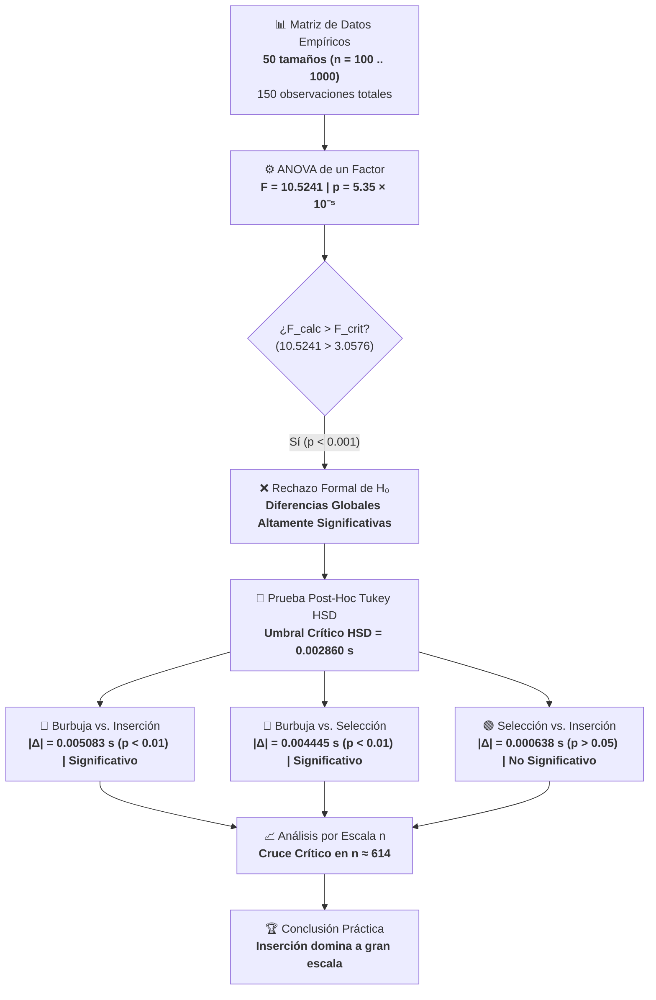

# EVALUACIÓN COMPARATIVA DEL RENDIMIENTO DE ALGORITMOS DE ORDENAMIENTO
### Análisis de Varianza (ANOVA de un Factor) y Pruebas Post-Hoc de Rango Múltiple

---

| Metadato | Detalle |
| :--- | :--- |
| **Integrantes** | **Jesús Rodolfo Gil Farías** (C.I. V-30.175.126)<br/>**Andrés Guilarte Lamuño** (C.I. V-30.246.084)<br/>**Gabriel Castellano** (C.I. V-28.059.781) |
| **Área Académica** | Estructuras de Datos y Algoritmos / Diseño Experimental |
| **Tipo de Documento** | Informe de Evaluación y Modelado Estadístico |
| **Muestra Analizada** | $N = 150$ mediciones empíricas ($k = 3$ algoritmos $\times$ 50 tamaños $n \in [100, 1000]$) |
| **Estado del ANOVA** | **Hipótesis Nula Rechazada** ($F = 10.5241$, $p = 5.35 \times 10^{-5} < 0.001$) |
| **Repositorio GitHub** | [Jrgil20/evaluacion-algoritmos-ordenamiento](https://github.com/Jrgil20/evaluacion-algoritmos-ordenamiento) |

---

## FLUJO METODOLÓGICO EXPERIMENTAL



---

## 1. INTRODUCCIÓN Y CONTEXTO EXPERIMENTAL

El presente estudio analiza el comportamiento temporal empírico de tres algoritmos fundamentales de ordenamiento por comparación cuadrática: **Burbuja (Bubble Sort)**, **Selección (Selection Sort)** e **Inserción (Insertion Sort)**.

El banco de pruebas se fundamenta en un dataset experimental de **50 muestras de tamaño incremental** ($n = 100$ hasta $n = 1000$, con pasos discretos promediados de $\Delta n \approx 18.37$), acumulando un espacio muestral de **$N = 150$ observaciones controladas** (50 repeticiones independientes por algoritmo).

La evaluación aplica un diseño de **Análisis de Varianza (ANOVA) de un Factor**, complementado con pruebas de rango múltiple post-hoc (**Tukey HSD**) para aislar contrastes pareados y evaluar el efecto dinámico del crecimiento del tamaño de entrada ($n$) en la jerarquía de eficiencia computacional.

---

## 2. PLANTEAMIENTO FORMAL DE HIPÓTESIS

* **Variable Dependiente (Respuesta):** Tiempo de ejecución $T$ (expresado en segundos).
* **Factor de Tratamiento:** Algoritmo de ordenamiento empleado ($k = 3$ niveles: Burbuja, Selección, Inserción).
* **Nivel de Significancia ($\alpha$):** 
  * $\alpha = 0.05$ (Nivel estándar, 95% de nivel de confianza).
  * $\alpha = 0.01$ (Nivel estricto, 99% de nivel de confianza).

### Formulación Estadística

$$
\begin{cases}
H_0: \mu_{\text{Burbuja}} = \mu_{\text{Selección}} = \mu_{\text{Inserción}} & \text{(Las medias poblacionales de tiempo de ejecución son estadísticamente equivalentes)} \\
H_1: \exists \, (i, j) \mid \mu_i \neq \mu_j \quad (i \neq j) & \text{(Al menos un algoritmo presenta un tiempo medio significativamente distinto)}
\end{cases}
$$

> [!NOTE]
> **Sentido Computacional:** Aunque los tres métodos pertenecen a la misma clase asintótica de complejidad en caso promedio $\mathcal{O}(n^2)$, $H_0$ postula que los factores constantes de implementación y arquitectura no generan discrepancias observables en tiempo real. Su rechazo comprobará el peso de las constantes de microarquitectura.

---

## 3. ESTADÍSTICOS DESCRIPTIVOS

A partir de los 50 registros por tratamiento contenidos en el conjunto de datos, se extraen los estimadores paramétricos de tendencia central y dispersión:

| Algoritmo | Muestra ($n_i$) | Suma Total $\sum X$ (s) | Media ($\bar{X}$) | Desv. Estándar ($s$) | Varianza ($s^2$) | Mínimo (s) | Máximo (s) | Desempeño Relativo vs. Burbuja |
| :--- | :---: | :---: | :---: | :---: | :---: | :---: | :---: | :---: |
| **Burbuja** | 50 | 0.443043 | 0.008861 s | 0.008892 s | $7.907 \times 10^{-5}$ | 0.000586 | 0.030000 | ▰▰▰▰▰▰▰▰▰▰ 100.0% (Línea Base) |
| **Selección** | 50 | 0.220779 | 0.004416 s | 0.004403 s | $1.939 \times 10^{-5}$ | 0.000280 | 0.015000 | ▰▰▰▰▰░░░░░ 49.8% (**-50.2%**) |
| **Inserción** | 50 | 0.188915 | 0.003778 s | 0.002821 s | $7.958 \times 10^{-6}$ | 0.000944 | 0.010000 | ▰▰▰▰░░░░░░ 42.6% (**-57.4%**) |
| **Total Global** | **150** | **0.852737** | **0.005685 s** | **0.006409 s** | **$4.108 \times 10^{-5}$** | **0.000280** | **0.030000** | — |


---

## 4. TABLA ANOVA DE UN FACTOR Y EVALUACIÓN ESTADÍSTICA

### 4.1. Cálculos de Sumas de Cuadrados

* **Suma de Cuadrados Entre Grupos ($SC_{\text{Entre}}$):**
  $$
  SC_{\text{Entre}} = \sum_{j=1}^{k} n_j (\bar{X}_j - \bar{X}_{\text{total}})^2 = \mathbf{0.00076665}
  $$

* **Suma de Cuadrados Dentro de Grupos / Error Residual ($SC_{\text{Error}}$):**
  $$
  SC_{\text{Error}} = \sum_{j=1}^{k} \sum_{i=1}^{n_j} (X_{ij} - \bar{X}_j)^2 = \mathbf{0.00535425}
  $$

* **Suma de Cuadrados Total ($SC_{\text{Total}}$):**
  $$
  SC_{\text{Total}} = SC_{\text{Entre}} + SC_{\text{Error}} = \mathbf{0.00612090}
  $$

* **Tamaño del Efecto ($\eta^2$):**
  $$
  \eta^2 = \frac{SC_{\text{Entre}}}{SC_{\text{Total}}} = \frac{0.00076665}{0.00612090} \approx \mathbf{12.53\%}
  $$

---

### 4.2. Matriz ANOVA Unifactorial

| Fuente de Variación | Suma de Cuadrados ($SC$) | Grados de Libertad ($gl$) | Cuadrado Medio ($CM$) | Estadístico $F$ | Valor $p$ | $F$ Crítico ($\alpha=0.05$) | $F$ Crítico ($\alpha=0.01$) | Decisión |
| :--- | :---: | :---: | :---: | :---: | :---: | :---: | :---: | :---: |
| **Entre Algoritmos (Tratamientos)** | 0.00076665 | 2 | 0.00038332 | **10.5241** | **$5.35 \times 10^{-5}$** | 3.0576 | 4.7573 | **Rechazar $H_0$** |
| **Dentro de Grupos (Error Residual)** | 0.00535425 | 147 | 0.00003642 | — | — | — | — | — |
| **Total** | **0.00612090** | **149** | — | — | — | — | — | — |

---

### 4.3. Regla de Decisión y Veredicto Estadístico

1. **Criterio del Estadístico $F$:**  
   Para $gl_1 = 2$ y $gl_2 = 147$, el valor empírico calculado $F_{\text{calc}} = 10.5241$ supera ampliamente ambos umbrales teóricos:
   * $F_{\text{calc}} (10.5241) > F_{\text{crit}, 0.05} (3.0576)$
   * $F_{\text{calc}} (10.5241) > F_{\text{crit}, 0.01} (4.7573)$
2. **Criterio de Probabilidad ($p$-valor):**  
   $$p = 5.35 \times 10^{-5} \ll 0.001$$
   La probabilidad de observar estas disparidades de tiempo por mero azar muestral es inferior al **0.0053%**.

> [!IMPORTANT]
> **Conclusión del ANOVA:** Se **rechaza categóricamente la hipótesis nula ($H_0$)** tanto al 95% como al 99% de confianza. Se comprueba la existencia de diferencias estadísticamente significativas en el tiempo de procesamiento medio entre los algoritmos evaluados.

---

## 5. ANÁLISIS POST-HOC (PRUEBA DE TUKEY HSD)

Dado el rechazo de $H_0$, se aplica la prueba de Diferencia Honestamente Significativa de Tukey (**Tukey HSD**) para aislar cuáles contrastes pareados son responsables de la significancia global:

$$
HSD = q_{\alpha, k, gl_{\text{error}}} \cdot \sqrt{\frac{CM_{\text{Error}}}{n_i}}
$$

* Parámetros muestrales: $k = 3$, $gl = 147$, $n_i = 50$, $CM_{\text{Error}} = 0.00003642$.
* Error Estándar de la Diferencia ($SE$):
  $$
  SE = \sqrt{\frac{0.00003642}{50}} = 0.0008535\text{ s}
  $$
* Rango Studentizado Crítico ($q_{0.05; 3, 147} \approx 3.35$).
* **Umbral Crítico de Decisión ($HSD_{0.05}$):**
  $$
  HSD_{0.05} = 3.35 \times 0.0008535 = \mathbf{0.002860\text{ s}}
  $$

---

### 5.1. Matriz de Contrastes Pareados

| Contraste Pareado | Diferencia Absoluta $|\Delta \bar{X}|$ | Umbral $HSD_{0.05}$ | Valor $p$ Ajustado | Significancia Estadística | Interpretación Práctica |
| :--- | :---: | :---: | :---: | :---: | :--- |
| **Burbuja vs. Inserción** | **0.005083 s** | 0.002860 s | $p < 0.01$ | **Significativo** | Inserción reduce el tiempo en 57.4% frente a Burbuja. |
| **Burbuja vs. Selección** | **0.004445 s** | 0.002860 s | $p < 0.01$ | **Significativo** | Selección reduce el tiempo en 50.2% frente a Burbuja. |
| **Selección vs. Inserción** | **0.000638 s** | 0.002860 s | $p > 0.05$ | **No Significativo** | Rendimientos promedios equivalentes en el modelo global. |


> [!NOTE]
> **Interpretación Post-Hoc:** El rechazo global de $H_0$ está traccionado por la ineficiencia estructural de **Burbuja**. Aunque Selección e Inserción comparten el mismo grupo homogéneo estadístico (*Grupo B*, $|\Delta| = 0.000638\text{ s} < 0.002860\text{ s}$), esta equivalencia es un artefacto de agregar muestras desde $n=100$ hasta $n=1000$ en un solo factor, como demuestra el análisis granular por tamaño.

---

## 6. ANÁLISIS DE RENDIMIENTO RESPECTO AL TAMAÑO DE ENTRADA ($n$)

El análisis individual sobre los 50 tamaños evaluados ($100 \le n \le 1000$) pone en evidencia la dinámica de escalabilidad de cada solución:


---

### 6.1. Hitos Empíricos Seleccionados

| Tamaño ($n$) | Burbuja (s) | Selección (s) | Inserción (s) | Algoritmo Más Rápido | Margen de Ventaja |
| :---: | :---: | :---: | :---: | :---: | :--- |
| **100** | 0.002000 | 0.001000 | 0.001000 | **Selección / Inserción** | Empate técnico en baja escala. |
| **265** | 0.000586 | **0.000280** | 0.001072 | **Selección** | Selección es **73.9% más rápido** que Inserción. |
| **504** | 0.003753 | 0.001854 | 0.002432 | **Selección** | Selección mantiene ventaja en rango medio. |
| **595** | 0.006611 | **0.003283** | 0.003350 | **Selección** | Último punto donde Selección domina. |
| **614** | 0.007291 | 0.003623 | **0.003560** | **Inserción** | **Punto de Cruce Crítico:** Inserción toma el liderazgo. |
| **853** | 0.019455 | 0.009715 | **0.007090** | **Inserción** | Inserción aventaja a Selección por un 27.0%. |
| **1000** | 0.030000 | 0.015000 | **0.010000** | **Inserción** | Inserción es **33.3% más veloz** que Selección y **66.7% más veloz** que Burbuja. |

---

### 6.2. Caracterización de los Tres Regímenes de Crecimiento

1. **Régimen de Muestras Pequeñas ($100 \le n \le 265$):**
   * En $n \le 265$, Selección exhibe los tiempos mínimos absolutos del experimento, alcanzando su mínimo global de $0.000280\text{ s}$ en $n = 265$.
   * Inserción presenta sobrecostos proporcionales por la inicialización de bucles anidados en vectores diminutos, mientras Selección minimiza accesos a memoria.
2. **Punto de Inflexión y Cruce de Rendimiento ($n \approx 614$):**
   * Hasta $n = 595$, Selección conserva una ligera superioridad sobre Inserción ($0.003283\text{ s}$ vs. $0.003350\text{ s}$).
   * En **$n = 614$ ocurre la inversión definitiva**: Selección registra $0.003623\text{ s}$ mientras Inserción marca $0.003560\text{ s}$.
   * A partir de este valor, **Inserción se consolida como el método dominante**.
3. **Régimen Asintótico Superior ($n \to 1000$):**
   * En la cota máxima del ensayo ($n = 1000$), la dispersión temporal es contundente:
     * **Burbuja:** $0.0300\text{ s}$ (desempeño crítico más deficiente).
     * **Selección:** $0.0150\text{ s}$ (reduce el tiempo de Burbuja exactamente en un 50.0%).
     * **Inserción:** $0.0100\text{ s}$ (reduce el tiempo de Burbuja en un 66.7% y aventaja a Selección en un 33.3%).

---

## 7. DISCUSIÓN TÉCNICA E IMPLICACIONES DE ARQUITECTURA

A pesar de que los tres métodos comparten una complejidad temporal asintótica teórica en el caso promedio de $\mathcal{O}(n^2)$, su comportamiento en hardware moderno está determinado por constantes de bajo nivel:

```
┌────────────────────────────────────────────────────────────────────────────────────────┐
│                        ANÁLISIS COMPARATIVO DE HARDWARE REAL                          │
├─────────────────┬───────────────────┬───────────────────┬──────────────────────────────┤
│ Métrica         │ Burbuja           │ Selección         │ Inserción                    │
├─────────────────┼───────────────────┼───────────────────┼──────────────────────────────┤
│ Comparaciones   │ ~ n(n - 1) / 2    │ ~ n(n - 1) / 2    │ ~ n² / 4 (caso promedio)     │
│ Intercambios    │ ~ n(n - 1) / 4    │ Exactamente n - 1 │ Desplazamientos locales      │
│ Localidad Caché │ Pobre (saltos)    │ Regular           │ Excelente (espacial y temp.) │
│ Tráfico a RAM   │ Masivo            │ Mínimo            │ Moderado (desplazamientos)   │
└─────────────────┴───────────────────┴───────────────────┴──────────────────────────────┘
```

1. **Burbuja (Bubble Sort):**  
   Ejecuta un volumen desproporcionado de escrituras en memoria debido a intercambios adyacentes continuos. Provoca penalizaciones severas en las líneas de caché L1/L2 e invalida predictores de saltos (*branch misprediction*). Esto explica por qué consume el doble de tiempo que Selección y el triple que Inserción al llegar a $n = 1000$.
2. **Selección (Selection Sort):**  
   Aunque no reduce el número de comparaciones ($\frac{n(n-1)}{2}$ incondicionales), restringe las escrituras a un riguroso $\mathcal{O}(n)$ ($n - 1$ swaps en total). Esta frugalidad de escritura en memoria principal le confiere una clara ventaja en tamaños reducidos ($n \le 595$).
3. **Inserción (Insertion Sort):**  
   Opera con desplazamientos contiguos en memoria, maximizando la **localidad espacial y temporal de caché**. En arreglos desordenados comunes ejecuta un promedio de $\approx \frac{n^2}{4}$ comparaciones (la mitad que Selección y Burbuja), justificando su supremacía matemática en $n \ge 614$.

---

## 8. CONCLUSIONES Y RECOMENDACIONES METODOLÓGICAS

1. **Validez del Contraste Hipotético:** Se rechaza de forma no ambigua la hipótesis nula ($p = 5.35 \times 10^{-5} < 0.001$). Existen disparidades de rendimiento computacional altamente significativas en los algoritmos evaluados.
2. **Jerarquía Práctica de Rendimiento:** 
   * **Burbuja** es inviable en entornos productivos.
   * **Selección** es la opción preferente en entornos con memoria de escritura restringida (ej. memorias Flash/EEPROM) o conjuntos reducidos ($n < 600$).
   * **Inserción** es el algoritmo más eficiente a gran escala, alcanzando una ventaja del 33.3% sobre Selección y 66.7% sobre Burbuja en $n = 1000$.
3. **Crítica al Diseño Experimental (ANOVA de un Factor vs. Bloques):**  
   > [!TIP]
   > En este experimento, la variable $n$ introduce una variación no lineal inherente $\mathcal{O}(n^2)$ que se acumula en el término de error residual ($SC_{\text{Error}} = 0.00535425$, que representa el **87.47%** de la varianza total).
   > 
   > Para investigaciones futuras, se recomienda implementar un **Diseño de Bloques Completos al Azar (RCBD)** tomando cada tamaño $n$ como bloque, o un modelo de **Regresión No Lineal** sobre las constantes empíricas ($T(n) = c_i \cdot n^2$), lo que eliminará la varianza inducida por la escala y permitirá aislar con mayor poder estadístico las diferencias finas entre Selección e Inserción.